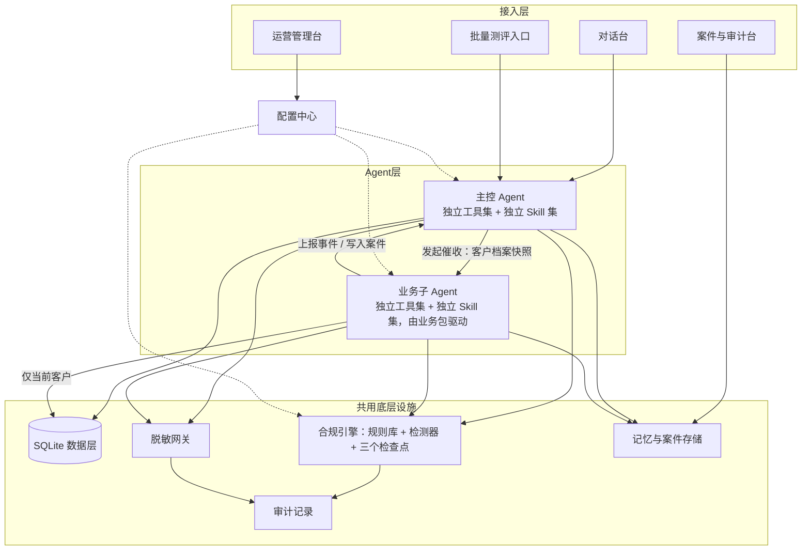
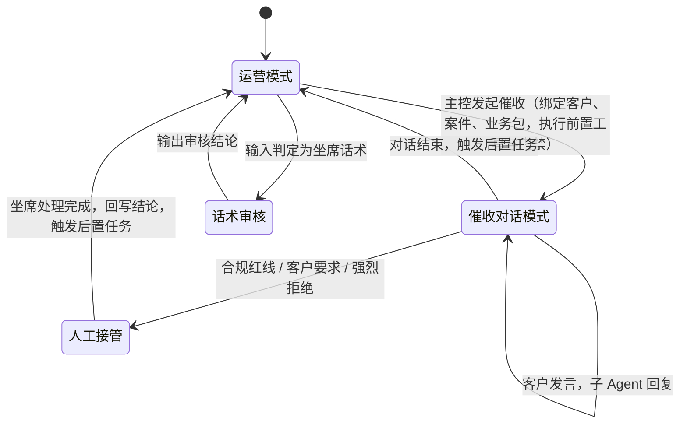

# 智能催收对话引擎 Agent 架构设计

- 状态：现行（已确认）
- 日期：2026-10-24
- 适用赛题：赛题08 金融催收对话引擎
- 范围：系统架构、业务约定与技术选型（第 15 节）。

## 1. 背景与目标

运营人员通过一个主控 Agent 完成客户画像查询、欠款查询、催收报告生成和发起催收；催收由按业务线配置的业务子 Agent 与客户对话完成。首个业务为催收，架构需支持后续业务（如车贷、车险续保）以「改配置」方式接入。

必须覆盖赛题七项功能：多轮催收对话、还款意愿评估、合规红线检测、分期方案协商、情绪感知、人工接管、催收报告；并满足评审对记忆、资产管理、工具调用、Skill 管理、鲁棒性、可解释性、数据合规的要求。

### 1.1 已确认的约束

- 底层对话模型：DeepSeek flash（外部 API，调用前必须脱敏）。
- 数据存储：SQLite，原始导入数据与系统生成数据放在同一数据库。
- 前端：TypeScript。
- 开发周期 1–3 天，1–2 人。

### 1.2 数据现状（影响设计的事实）

- 公开测评集输入的说话人混杂：客户发言（Q002/Q003/Q004/Q006/Q007/Q009）、坐席话术（Q001/Q005）、运营提问（Q008/Q010）。
- 数据为随机生成，内部不自洽：`fact_overdue` 40 条中 36 条的 `loan_id` 属于其他客户；`recommended_template_id` 与模板适用条件存在冲突；情绪类型与触发话术不对应。
- 标准答案中的数字不来自数据（如 Q007 称 3 笔逾期，C0007 实际 1 笔；Q010 称 156 次催收，全表 50 条）。系统一律以查询到的数据为准，冲突处标注「需人工复核」。
- 历史催收记录中无违规样本（无 22:00–8:00 通话，单客户单日最多 2 次，`violated_rule_id` 全空），红线检测效果需靠自建测试用例验证。

## 2. 术语

| 术语 | 含义 |
| --- | --- |
| 运营人员 | 系统使用者，通过主控 Agent 查询、发起催收、看报告 |
| 坐席 | 向客户说话的一方，包括 AI 坐席（业务子 Agent）和人工坐席 |
| 主控 Agent | 唯一入口，负责模式切换、调度、监督、运营侧能力 |
| 业务子 Agent | 由一份业务包驱动的、面向客户对话的 Agent |
| 业务包 | 一条业务线的完整配置（第 5 节） |
| 案件 | 客户 + 业务包 + 若干次会话及其产出物 |

## 3. 整体架构

### 3.1 主控 Agent 统一调度：会话三种模式

主控每轮判定输入归属，优先级从高到低：

1. 会话当前模式：处于催收对话模式时，未标明角色的输入视为客户发言，直接交给子 Agent，直到结束或转人工；处于人工接管模式时，未标明角色的输入视为人工坐席发言。运营在会话中下指令（如结束催收）需显式标明运营角色。
2. 显式标记：界面角色选择（运营 / 客户 / 审核话术）；批量测评时以 `scene_type` 作为提示。
3. 大模型分类：输出说话人及置信度，置信度低于阈值时进入关键词兜底。
4. 关键词兜底：按坐席与运营标记词计数判定；句中出现客户编号（如 C0001）计为偏向运营的信号；仍无法判定时，交互场景先反问确认，批量测评按客户发言处理并标注「需人工复核」。

切换权只在主控。子 Agent 不能自行切换模式，只能上报事件（申请转人工、对话结束、承诺还款、被合规拦截）。

### 3.2 主控与子 Agent 能力隔离

两者的工具和 Skill 分别注册、分别配置，互不调用。

| | 主控 Agent | 业务子 Agent |
| --- | --- | --- |
| 数据范围 | 任意客户，可做汇总统计 | 仅当前绑定客户；客户编号由系统注入，大模型不可填写 |
| 工具 | 客户画像查询、欠款查询、催收历史统计、规则查询、时段与频次检查、发起或结束催收、案件管理、后置任务写入 | 查当前客户逾期、查可用分期模板、记录还款承诺、提交减免申请、上报事件 |
| Skill | 画像分析（含对话前意愿评分）、多笔欠款优先级、催收报告生成（单客户 / 汇总）、话术审核、催收发起 | 意图识别、情绪识别、对话中意愿评分更新、分期方案协商、多笔逾期优先级（仅当前客户）、话术生成、对话小结 |
| 配置位置 | 主控配置 | 各业务包 |

两者之间只有两条数据通道：

- 主控到子 Agent：发起时生成「客户档案快照」，作为子 Agent 初始记忆。
- 子 Agent 到主控：对话记录、协商记录、意愿评分变化、上报事件写入案件；主控生成报告时读取案件。

算法可在底层复用同一计算函数，但注册、权限和参数各自独立。

### 3.3 主控运营模式能力

| 运营需求 | 主控能力 | 对应测评题 |
| --- | --- | --- |
| 查询客户画像 | 画像、行为、情绪、还款历史工具 + 意愿评分 | — |
| 查询客户欠款 | 逾期、贷款工具 + 多笔优先级 | Q007（运营视角） |
| 单客户催收报告 | 报告生成 Skill（读取案件、对话、审计） | — |
| 汇总报告 | 报告生成 Skill 汇总模式 | Q010 |
| 合规问答（能否外呼） | 规则查询 + 时段与频次检查 | Q008 |
| 发起 / 结束催收 | 模式切换 + 前置工具 + 门禁 | — |
| 审核一句坐席话术 | 合规检查点一（审核模式） | Q001、Q005 |

报告中的数字只能来自工具实际查询结果。

## 4. 数据层

- 9 张 CSV（4 维表、5 事实表）及 `schema_relationships.csv` 导入 SQLite，导入时做主外键校验并生成数据质量报告（列出所有关系冲突的记录编号）。
- 原始数据与系统生成数据同表存放，每张业务表增加三列：`来源`（原始导入 / 系统生成）、`会话编号`、`写入时间`。
- 原始数据只读：只有导入程序可写入「原始导入」行。
- 重置：删除全部「系统生成」行即回到初始状态；原始数据可随时从 CSV 重新导入。
- 系统运行时表（会话、记忆、案件、产出物、审计、待办、配置版本）同库存放。

## 5. 业务包与管理台

### 5.1 业务包配置项

| 配置项 | 作用 |
| --- | --- |
| 适用范围 | 主控匹配业务包的条件（如贷款类型） |
| 前置工具 | 发起时强制执行的工具，每个工具配置失败策略：阻断 / 降级继续 / 仅告警 |
| 前置门禁 | 不通过即不开始对话，引用规则编号（如 R004、R005）；只在外呼渠道执行 |
| 对话阶段 | 各阶段目标、允许意图、推进条件（如核身 → 告知逾期 → 了解原因 → 协商 → 确认承诺 → 结束） |
| 意图到动作映射 | 识别出某客户意图后调用哪个 Skill |
| Skill 参数 | 可用分期模板范围、意愿评分权重等 |
| 合规规则集 | 检查点一启用的规则编号及处置覆盖，可追加业务专属规则 |
| 转人工条件 | 见 7.2 |
| 话术约束 | 身份声明模板、禁用词、语气要求 |
| 报告模板 | 报告章节 |
| 后置任务 | 通话结束后异步执行的任务列表（见第 8 节） |

会话渠道分两种：

- 外呼：运营发起，执行前置门禁，从第一个阶段（核身）开始。
- 客户进线：客户主动来电或发言，不检查 R004、R005，视为已核身，从第二个阶段（告知逾期）开始。

### 5.2 管理台页面

1. 业务包管理：新建、复制、编辑。
2. 前置工具与后置任务配置：从工具注册表勾选并设置失败策略。
3. 合规配置：规则库（导入 `dim_compliance_rule`，可增删改，补充判定方式）、三个检查点的启用规则与处置覆盖。
4. 分期模板库：导入 `dim_installment_template`，适用条件结构化字段可编辑，保留原文。
5. 评分与策略配置：意愿评分权重、等级阈值、策略表、意图对应关系表。
6. 工具注册表（只读）：输入输出契约、超时、重试次数、近期调用状态。

保存时校验：引用的工具和规则编号存在、阶段连通。配置变更只对新会话生效，审计记录写明会话使用的配置版本。

### 5.3 实现范围

- 完整实现「通用消费金融催收」业务包。
- 另做一个「车贷」业务包，只改配置不改代码，用于演示适配能力。
- 非催收业务（如车险续保）只在技术方案文档中说明扩展方式，不实现。

## 6. 合规引擎

规则库、检测器、审计格式全系统只有一份；检查点决定「在哪里查、用哪些规则、命中后怎么处置」。

### 6.1 三个检查点

| | 检查点一：坐席话术 | 检查点二：运营操作 | 检查点三：客户输入 |
| --- | --- | --- | --- |
| 检查对象 | AI 坐席回复草稿；人工坐席与审核模式下输入的坐席话术 | 发起外呼 / 催收、批量任务、查询或导出客户数据 | 客户发言 |
| 关注规则 | R001、R002、R003、R006、R007、R008、R009、R010 | R004、R005、R006（导出脱敏）、R009（联系对象为本人） | 不判客户违规，识别风险信号：辱骂、投诉威胁、明确拒绝、要求转人工 |
| 判定方式 | 关键词 + 大模型语义判定（虚假承诺、变相威胁）+ 单轮施压计数 | 仅确定性判断：时间、次数、权限 | 由情绪识别与意图识别完成 |
| 处置 | AI 草稿：拦截后改写重审，最多 2 次；严重级或仍不合规则改用安全兜底话术并上报转人工，客户看不到违规内容。人工 / 审核话术：拦截，给出合规改写建议，转人工或通知主管 | 阻断操作，告知原因与下次允许时间，不转人工 | 降低语气强度、安抚；达到阈值由主控转人工 |
| 测评题 | Q001、Q005、Q009 | Q008 | Q004、Q006 |

计数口径：

- 单日联系次数（R005）：不计外呼被拦截的记录和客户进线记录。
- 重复施压（R010）：按会话累计施压表述次数；只有当前这句含施压表述、且累计超过上限时才判定命中。

### 6.2 配置与审计

- 规则保留 `dim_compliance_rule` 的默认处置动作；各检查点配置启用规则及处置覆盖；业务包可在检查点一追加规则。
- 每条审计记录包含：日志编号、时间、客户编号（脱敏）、检查点、场景、话术或操作摘要、命中规则编号、规则类型、违规等级、处置动作、是否转人工、配置版本。
- 规则条文只引用规则库内容，不生成规则库以外的法规条款。

## 7. 对话流程与人工接管

### 7.1 单轮处理（催收对话模式）

1. 输入预处理：空输入、乱码、超长截断、重复输入的识别与兜底回复。
2. 理解（大模型）：客户意图、情绪类型及强度、关键信息（金额、日期、期数），附置信度；同时完成检查点三。
3. 更新记忆：情绪轨迹、承诺、可承受月供等会话事实。
4. 决策（确定性）：按业务包阶段与意图映射确定动作，判断转人工条件。
5. 执行 Skill 或工具（确定性）：分期测算、意愿评分更新等。
6. 生成话术（大模型）：只能引用第 5 步产出的事实与数字。
7. 检查点一审核草稿，处置见 6.1。
8. 发出回复，写入对话记录与审计，推进阶段。

大模型只参与第 2 步和第 6 步，均要求结构化输出。意图分两层：客户意图（要求宽限、要求分期、要求减免、投诉、要求转人工、询问欠款、拒绝还款、承诺还款、质疑身份、其他）与系统意图（与 `expected_intent` 对齐：提醒催收、还款意愿评估、分期方案协商、情绪感知、合规检测、人工接管、多贷款管理、催收报告），对应关系在配置中维护。置信度低或意图冲突时向客户澄清，并标注「需人工复核」。

### 7.2 人工接管

触发条件（业务包可配置）：

- 检查点一命中严重级规则，或草稿改写 2 次仍不合规。
- 客户明确要求转人工。
- 客户连续拒绝次数或情绪强度超过阈值。
- 识别置信度连续偏低。

移交包：脱敏客户档案快照、对话全文、情绪轨迹、意愿评分及依据、协商记录与已确认承诺、命中规则、转接原因、建议下一步。

流程：客户收到过渡话术（告知无需重复内容）→ 人工坐席在接管页面查看移交包并继续沟通，其话术同样经过检查点一 → 结束后结论回写案件，会话交还主控并触发后置任务。

### 7.3 记忆

| 层次 | 内容 | 生命周期 |
| --- | --- | --- |
| 对话上下文 | 最近若干轮原文 + 滚动摘要 | 单次会话 |
| 会话事实 | 是否核身、意愿评分、宽限请求、承诺金额与日期、已选方案、拒绝次数、本轮施压次数 | 单次会话，结束后归档至案件 |
| 客户长期记忆 | 历史承诺及履约、方便联系时段、投诉记录 | 跟随客户 |

每条记忆记录来源（对话轮次或数据记录编号），可在界面查看、纠正、清除；纠正与清除操作写入审计。

## 8. 通话结束后的异步后置任务

触发：子 Agent 上报对话结束；人工坐席处理完成；前置门禁拦截（拦截也留记录）。由主控执行，子 Agent 只上报结束事件与通话摘要。

| 阶段（同阶段内并行） | 任务 | 写入位置 |
| --- | --- | --- |
| 一、写入记录 | 本次通话记录（时间、方式、话术摘要、结果、坐席编号 AI / 人工、命中规则） | `fact_call_history`，来源为系统生成 |
| | 客户行为（承诺还款、申请延期、拒绝沟通等） | `fact_user_behavior`，来源为系统生成 |
| | 情绪（峰值与结束时情绪） | `fact_emotion_log`，来源为系统生成 |
| 二、更新画像 | 重新生成客户画像并重算意愿评分，保存为新版本；更新客户长期记忆 | 画像快照表 |
| | 生成本次催收报告 | 案件产出物 |
| 三、生成待办 | 承诺还款日跟进、减免申请审批、下次可联系时间 | 待办表 |

约束：异步不阻塞，案件台展示每个任务状态（等待 / 执行中 / 完成 / 失败）并支持重试；单任务失败不影响其他任务，重试仍失败则标红并生成待办；按会话编号保证幂等，重试不产生重复记录。

## 9. 还款意愿评分

加权求和得 0–100 分，权重在管理台配置。

| 因素 | 数据来源 | 方向 |
| --- | --- | --- |
| 还款履约 | 按时还款比例、近期还款次数与金额 | 正向 |
| 逾期严重度 | 最长逾期天数、总欠款与月收入之比 | 负向 |
| 行为信号 | 承诺还款、查看账单、查看分期方案（正）；拒绝沟通、修改联系方式（负） | 正负 |
| 历史催收结果 | 承诺还款、部分还款、协商分期（正）；挂断、拒绝沟通、无人接听（负） | 正负 |
| 情绪 | 配合（正）；抵触、冷漠、愤怒（负） | 正负 |
| 信用画像 | 信用评分、客户等级 | 正向 |
| 本次对话表态 | 仅子 Agent 实时叠加：承诺、请求宽限、拒绝 | 正负 |

输出：分数、等级（高 / 中 / 低，阈值可配置）、各因素贡献分及依据记录编号、置信度（依据数据覆盖度与冲突情况）；置信度低或数据冲突时标注「需人工复核」。

建议策略由「意愿等级 × 逾期天数区间」查策略表得出（如温和提醒、协商分期、提交结清减免申请、转人工重点跟进），策略表可配置。

## 10. 分期协商

1. 筛选模板：模板适用条件转为结构化字段（保留原文），按逾期天数与信用评分筛选；数据中的推荐模板与适用条件冲突时以适用条件为准，并在报告中注明。
2. 计算方案：按欠款金额、期数、利率、手续费计算月供与总成本；利率按年化、等额本息，口径在方案与报告中写明。
3. 匹配承受能力：以客户表述的可承受月供为准；未表述时按月收入的可配置比例估算；给出 2–3 个方案，均说明利率与手续费。
4. 多轮调整：客户改期数或月供时重算；超出模板上限时说明无法办理，不作承诺；减免只能「提交申请」，不承诺结果。
5. 每轮记录方案、客户反馈与结果，进入报告「协商记录」。

多笔逾期优先级：默认按逾期天数降序，天数相同按金额降序，规则可配置。

## 11. 案件与资产管理

- 案件状态：待发起 → 前置检查 → 对话中 → 人工接管中 → 后置处理中 → 已完成 → 已归档。
- 资产：对话记录、催收报告、审计日志、移交包、待办，均挂在案件下，可按客户、状态、命中规则、时间检索并归档。
- 催收报告章节：逾期概况、还款意愿评估、情绪感知、合规审计、协商记录、建议策略。

## 12. 鲁棒性、可解释性、数据合规

- 鲁棒性：异常输入（乱码、空输入、意图冲突、极端值、超长或乱序对话）给出明确兜底回复，不崩溃、不静默；工具与大模型调用设置超时与重试，超时后告知用户并给出下一步；前置工具按失败策略阻断或降级。
- 可解释性：每个结论附命中规则编号、涉及的逾期记录编号、金额、时间；界面展示处理轨迹（路由判定、工具调用及结果、Skill 输出、合规检查结论）；不确定项给出置信度并标注「需人工复核」；确定性环节保证同输入同输出。
- 数据合规：调用大模型前经脱敏网关替换姓名、证件号、手机号、金额，返回后还原；每次外部调用记录入参（脱敏后）、时间、用途；界面、日志、导出文件中的敏感字段同样脱敏。

## 13. 测评输出

- 批量运行：每道题走与界面完全相同的主控流程；题目中给出的时间（如「晚上 11 点」）作为模拟当前时间，否则使用系统时间。
- 输出文件：`utf-8-sig` CSV，列名与 `公开测试集答案.csv` 对齐，另加命中规则编号、意愿评分、建议策略、处理轨迹编号。
- 对照评测：独立离线脚本逐题统计意图一致率与要点覆盖率；标准答案只出现在该脚本中，不进入提示词、配置或代码常量。
- 红线专项：为违规时段、频次超限、虚假承诺、辱骂威胁四类自建测试用例，统计漏检与误报。

## 14. 明确不做

- 非催收业务包的实现（仅文档说明扩展方式）。
- 真实外呼、语音识别与合成。
- 主控与子 Agent 共用工具或 Skill 注册。
- 修改原始导入数据。
- 发给客户的坐席回复在合规审核通过前逐字流式输出。

## 15. 技术选型

| 层 | 选型 |
| --- | --- |
| 后端 | Python 3.11 及以上 + FastAPI |
| 编排 | 自研：模式状态机、主控与子 Agent 两套独立的工具和 Skill 注册表、业务包驱动的阶段机 |
| 契约与校验 | Pydantic（工具与 Skill 输入输出、大模型结构化输出） |
| 大模型 | DeepSeek flash，OpenAI 兼容接口，JSON 输出模式，超时与重试；模型名与接口地址通过配置文件提供。工具调用由编排器按配置执行，不依赖模型函数调用 |
| 数据 | SQLite，标准库 `sqlite3`，不使用 ORM |
| 业务配置 | YAML 文件作为初始配置；管理台修改后写入 SQLite 并记录版本 |
| 异步后置任务 | SQLite 任务表 + 进程内后台线程池 |
| 前端 | TypeScript + React + Vite + Ant Design；页面：对话台、运营管理台、案件与审计台 |
| 前后端契约 | FastAPI 生成 OpenAPI，`openapi-typescript` 生成前端类型 |
| 流式通道 | SSE |
| 测评 | 命令行批量运行脚本 + 独立离线对照脚本，直接调用后端核心 |
| 部署 | `requirements.txt` + 一键启动脚本；前端打包为静态文件由 FastAPI 托管，单端口；可选 Dockerfile |

开发顺序：先完成后端核心与命令行测评，再接入前端，保证前端未完成时测评结果可先产出。

### 15.1 流式输出约定

| 输出内容 | 方式 |
| --- | --- |
| 处理轨迹（主控判定、前置工具、意图与情绪识别、Skill 结果、合规检查结论） | 每完成一步推送一个事件 |
| 运营模式回答（画像、欠款、报告、合规问答） | 大模型逐字流式推送，显示前脱敏 |
| 发给客户的坐席回复 | 后台生成完整草稿并通过检查点一后，再以逐字效果推送；被拦截时客户只收到改写后或兜底话术 |
| 理解步骤的 JSON 输出 | 不流式，解析完成后作为一条轨迹事件推送 |
