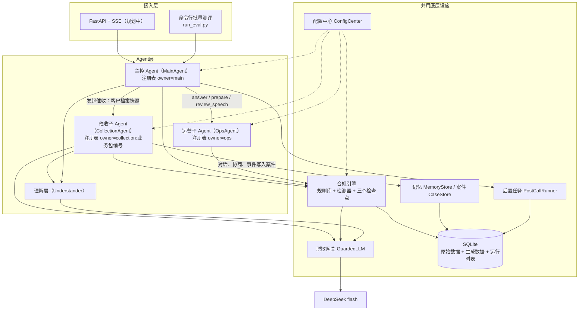
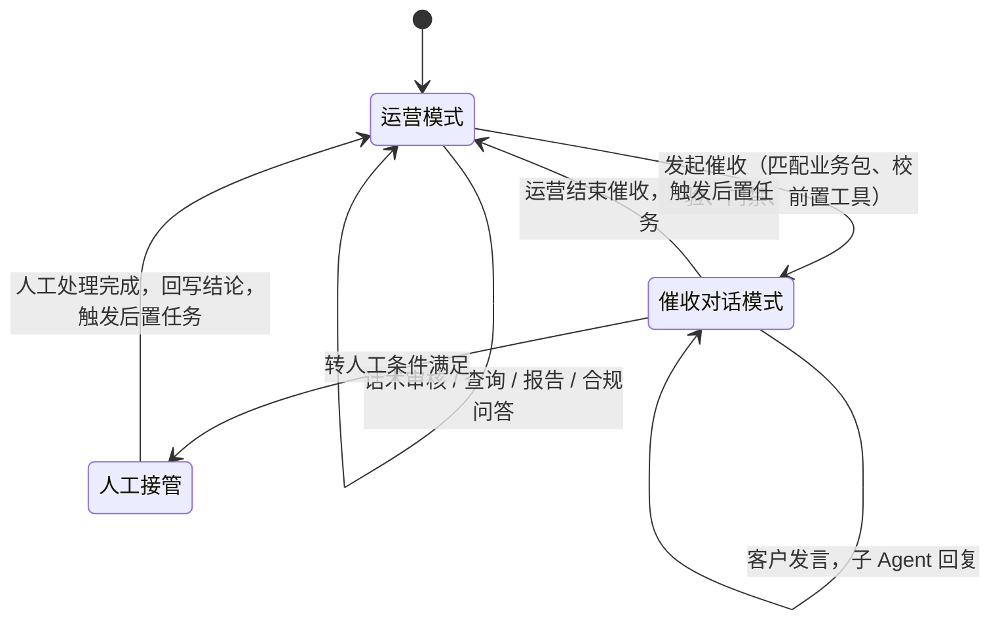
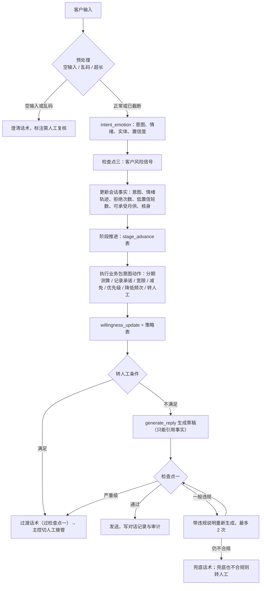

# 赛题08 金融催收对话引擎 · 技术方案

- 版本：v0.1（后端核心已实现，接口与前端规划中）
- 日期：2026-10-24
- 架构与业务约定：`docs/superpowers/specs/2026-10-24-collection-agent-design.md`（现行规格）
- 本文：实现层面的技术方案，所有数值、接口、表结构以当前代码为准

## 0. 实现状态与模块分工

### 0.1 实现状态

| 部分 | 状态 | 位置 |
| --- | --- | --- |
| 数据导入、建模与数据质量检查 | 已实现 | `backend/cagent/db.py`、`importer.py` |
| 主控 Agent、运营子 Agent、催收子 Agent、理解层 | 已实现 | `backend/cagent/agents/` |
| 合规引擎、审计日志 | 已实现 | `compliance.py`、`audit.py` |
| 还款意愿评分、分期测算、多笔优先级 | 已实现 | `scoring.py`、`installment.py`、`loans.py` |
| 记忆、案件与资产、异步后置任务、报告 | 已实现 | `memory.py`、`cases.py`、`postcall.py`、`reports.py` |
| 配置中心与两个业务包 | 已实现 | `config_center.py`、`backend/config/` |
| 脱敏网关与大模型客户端 | 已实现 | `desensitize.py`、`llm.py` |
| 命令行批量测评、对照评测、红线专项 | 已实现 | `backend/scripts/` |
| FastAPI 接口、SSE 流式通道、TS 前端 | 规划中 | 第二阶段计划 |

自动化测试 140 个全部通过；离线模式跑公开测评集 10 题全部有输出；红线专项 19 条样例漏检 0、误报 0（见第 14 节）。

---

## 1. Agent 架构

### 1.1 总体结构



### 1.2 角色划分

| 角色 | 实现 | 职责 |
| --- | --- | --- |
| 主控 Agent | `agents/main.py` 的 `MainAgent` | 唯一入口；判定说话人；在运营模式、催收对话模式、人工接管三种模式间切换；发起与结束催收 |
| 运营子 Agent | `agents/ops.py` 的 `OpsAgent` | 画像、欠款、报告、合规问答、话术审核、发起前的外呼门禁与客户快照 |
| 催收子 Agent | `agents/collection.py` 的 `CollectionAgent` | 由一份业务包驱动，只服务一个已绑定客户，负责多轮催收对话 |
| 理解层 | `agents/understanding.py` 的 `Understander` | 输入预处理、说话人判定、客户意图情绪与实体抽取、运营指令理解 |
| 人工坐席 | 主控的人工接管模式 | 接收移交包继续沟通，其话术同样过合规检查点一 |

模式切换只由主控完成。子 Agent 不能切换模式，只能返回「需要转人工」及原因，由主控生成移交包并切到人工接管。

### 1.3 编排方式

不依赖大模型的函数调用能力，编排是确定性的代码流程：

1. 主控根据会话模式和说话人判定结果选择处理分支。
2. 子 Agent 每轮按「理解 → 更新记忆 → 阶段推进 → 按业务包意图动作表调用工具和 Skill → 意愿评分 → 生成话术 → 合规审核」顺序执行（详见 3.3）。
3. 大模型只在以下环节出现，全部要求 JSON 结构化输出，任务代号写入调用日志：

| 任务代号 | 用途 | 失败时 |
| --- | --- | --- |
| `speaker` | 说话人判定 | 关键词兜底 |
| `understand` | 客户意图、情绪、实体 | 关键词兜底 |
| `operator_intent` | 运营指令理解 | 关键词兜底 |
| `reply` | 生成坐席话术 | 业务包话术模板 |
| `compliance_semantic` | 合规语义判定（虚假承诺、变相威胁等） | 仅按关键词判定并标注需人工复核 |
| `rewrite` | 违规话术的合规改写建议 | 业务包兜底话术 |

### 1.4 工具层与 Skill 层

主控、运营子 Agent 和催收子 Agent 各有一个 `Registry` 实例，owner 分别为 `main`、`ops`、`collection:<pack_id>`。注册项分两类：`tool`（查询或写入数据的原子操作）和 `skill`（组合计算或大模型能力）。每个注册项声明 Pydantic 输入输出模型、超时和重试次数。

`Registry.call` 的统一行为：

- 入参用输入模型校验，失败直接报错，不重试。输出校验失败同样不重试。
- 在共享线程池中执行。超时或工具内部异常按重试次数重试，再次尝试前等待 `min(0.2 × 2^(已失败次数), 1)` 秒。
- 每次尝试写一条轨迹事件，状态为 `ok`、`retry` 或 `error`，带耗时、入参和出参。
- 最终失败抛出 `CallError`，并带上是否可重试。调用方按场景降级。话术生成超时降级时，客户可见回复以「话术生成超时，已改为模板说明。」开头。

主控注册表 owner 为 `main`，当前没有业务查询和规则校验工具。

运营子 Agent 注册表（owner 为 `ops`）：

| 名称 | 类型 | 说明 |
| --- | --- | --- |
| `get_customer_profile` | tool | 基本信息、近 10 条行为、近 5 条情绪、近 10 条还款、客户长期记忆 |
| `get_overdues` | tool | 全部逾期记录及处理优先级 |
| `get_contact_count_today` | tool | 指定日期已联系次数（不含外呼拦截与客户进线） |
| `get_willingness` | tool | 对话前还款意愿评分 |
| `customer_report` | skill | 单客户催收报告 |
| `summary_report` | skill | 月度催收汇总报告 |

催收子 Agent 注册表（owner 为 `collection:<pack_id>`）。所有入参都不包含客户编号，客户编号在构造时绑定，大模型无法指定其他客户：

| 名称 | 类型 | 说明 |
| --- | --- | --- |
| `get_my_overdues` | tool | 当前客户的逾期记录 |
| `get_my_templates` | tool | 本业务包允许的分期模板 |
| `record_promise` | tool | 记录还款承诺（不重试，避免重复写入） |
| `record_grace_request` | tool | 记录宽限请求 |
| `submit_waiver_request` | tool | 登记减免申请，只登记不承诺结果 |
| `reduce_contact` | tool | 记录降低联系频次诉求，同时写入客户长期记忆的投诉记录 |
| `request_handoff` | tool | 申请转人工 |
| `intent_emotion` | skill | 意图、情绪、实体识别（超时 40 秒） |
| `willingness_update` | skill | 叠加本次对话表态更新意愿评分 |
| `installment_plan` | skill | 生成或调整分期方案 |
| `loan_priority` | skill | 当前客户多笔逾期优先级 |
| `generate_reply` | skill | 按阶段目标与事实生成话术（超时 40 秒） |
| `dialog_summary` | skill | 对话小结 |

业务包的 `intent_actions` 只能引用子 Agent 已注册的动作，`pre_tools` 只能引用主控已注册的工具，发起催收前会校验（见 13.2）。

### 1.5 记忆层

| 层次 | 存储 | 内容 | 生命周期 |
| --- | --- | --- | --- |
| 对话上下文 | `messages` 表 | 每轮原文；`CaseStore.context` 返回最近 6 句原文和更早内容的滚动摘要（每句截前 20 字并带意图） | 单次会话 |
| 会话事实 | `memory` 表，`scope=session` | 是否核身、意图列表、情绪轨迹、连续拒绝次数、连续低置信轮数、可承受月供、承诺、宽限请求、减免申请、协商记录、意愿评分、建议策略、施压累计次数、联系偏好、门禁拦截信息、人工处理结论 | 单次会话，结束后随案件保留 |
| 客户长期记忆 | `memory` 表，`scope=customer` | 投诉记录、最近一次意愿评分、最近一次联系结果、未结承诺 | 跟随客户 |

每条记忆都记录来源（如「意图识别」「客户表述」「record_promise」「会话 S-xxx」）。写入新值时旧值标记为 `superseded`，保留完整历史；人工纠正和清除分别标记为新值和 `cleared`，并写入审计日志（检查点为「记忆操作」）。

---

## 2. 数据导入与建模

### 2.1 装载

`python scripts/init_db.py` 调用 `importer.import_all`，把赛题 9 张 CSV 导入 SQLite（默认 `backend/runtime/collection.db`，WAL 模式）：

| 表 | 类型 | 行数 | 主要字段 |
| --- | --- | --- | --- |
| `dim_customer` | 维表 | 10 | 客户编号、姓名、年龄、职业、月收入、信用评分、地区、客户等级 |
| `dim_loan` | 维表 | 30 | 贷款编号、客户编号、贷款类型、本金、年化利率、期数、放款日、到期日 |
| `dim_compliance_rule` | 维表 | 10 | 规则编号、类型、内容、违规等级、处置动作 |
| `dim_installment_template` | 维表 | 6 | 模板编号、类型、最长期数、利率、手续费率、适用条件 |
| `fact_overdue` | 事实表 | 40 | 逾期编号、客户、贷款、金额、天数、期次、最近还款日、推荐模板 |
| `fact_call_history` | 事实表 | 50 | 通话编号、客户、时间、方式、摘要、结果、坐席、违规规则 |
| `fact_repayment` | 事实表 | 40 | 还款编号、客户、金额、时间、方式、是否按时 |
| `fact_user_behavior` | 事实表 | 40 | 行为编号、客户、类型、时间、详情 |
| `fact_emotion_log` | 事实表 | 40 | 情绪编号、客户、类型、强度、触发话术、时间 |

导入时按列定义做类型转换（整数、浮点、文本，空串转为空值），缺列直接报错。

### 2.2 主外键校验与口径统一

`schema_relationships.csv` 描述的关系在 `importer.FK_CHECKS` 中逐条校验（逾期→客户/贷款/模板，通话→客户/规则，还款、行为、情绪、贷款→客户），另外校验「逾期记录的贷款是否属于同一客户」。不一致的记录写入 `data_quality` 表，不修改原始数据。

当前数据共发现 36 条冲突，全部是 `fact_overdue` 中贷款归属与逾期客户不一致。这些冲突会传递到下游：

- 多笔逾期优先级在对应条目上标注「需人工复核」。
- 还款意愿评分的置信度扣减 0.15，并在复核原因中写明冲突记录编号。
- 报告的「数据冲突」章节列出全部冲突。

口径约定：欠款以 `fact_overdue.overdue_amount` 合计为准；贷款类型取优先级最高的逾期记录所关联的贷款；推荐模板与适用条件冲突时以适用条件为准，并在协商结果中注明。

### 2.3 原始数据与生成数据同表

9 张业务表都增加三列：`source`（原始导入 / 系统生成）、`session_id`、`written_at`。

- 每张表建有 `BEFORE UPDATE` 和 `BEFORE DELETE` 触发器：当被修改行的 `source` 为「原始导入」时报错「原始数据只读」。
- 系统生成的记录只能通过 `db.insert_generated` 写入，字段名先做白名单校验。
- 重置：`importer.reset_generated` 删除所有「系统生成」行并清空运行时表；原始数据可由 `init_db.py` 从 CSV 重新导入。
- 测评库：公开题与非公开题分开跑，都从公开 CSV 重建，不从 `collection.db` 复制，也不改 `collection.db`。`run_eval.py --suite public` 写入 `eval_public.db`；`--suite private` 在同一批公开数据上追加非公开工作簿，写入 `eval_private.db`。客户编号保持原号；与公开主键冲突的本批贷款、逾期、还款、行为、情绪、通话记录改为 `P-` 前缀，并改写本批外键。两次都清空各自测评库的运行时表。不带会话、消息、报告。

### 2.4 运行时表

| 表 | 用途 |
| --- | --- |
| `cases` | 案件：客户、业务包、状态 |
| `sessions` | 会话：所属案件、模式、业务包、配置版本、渠道（外呼 / 客户进线）、开始与结束时间、结束原因 |
| `messages` | 对话记录：轮次、角色、原文、元数据（意图、阶段等） |
| `memory` | 会话事实与客户长期记忆，含来源和状态 |
| `artifacts` | 案件资产：催收报告、移交包、汇总报告 |
| `audit_log` | 合规审计与关键事件 |
| `llm_calls` | 大模型调用日志：时间、任务代号、脱敏后入参与出参、状态、耗时 |
| `todos` | 待办：承诺跟进、减免审批、宽限跟进、下次可联系、主管复核、后置任务失败 |
| `post_tasks` | 后置任务状态，主键为（会话编号, 任务名） |
| `profile_snapshots` | 客户画像快照，按客户递增版本 |
| `config_versions` | 配置版本，主键为（类型, 键, 版本号） |
| `data_quality` | 数据质量问题 |

---

## 3. 对话管理

### 3.1 会话模式



会话渠道分两种：

- 外呼：运营发起，执行外呼门禁（R004、R005），从「核身」阶段开始，首句为规范开场白（身份与工号、核身请求、来意）。
- 客户进线：客户直接发言时自动建立，不检查 R004、R005，视为已核身，从「告知逾期」阶段开始。

### 3.2 说话人判定

`MainAgent.handle` 每轮按以下优先级判定输入归属：

1. 人工接管中的会话：客户发言只记录；其余发言按人工坐席话术审核。
2. 大模型判定：看当前这句话，并附上本会话最近一轮（至多两条，每条最多 200 字）。没有历史时不附。置信度不低于 0.6 时采用，覆盖界面角色。`scene_type` 只作参考。
3. 关键词兜底：分别统计坐席标记词和运营标记词（`intents.yaml` 的 `speaker_markers`）的命中数，句中出现客户编号（如 C0001）给运营计数加 1，多者胜出。命中后同样覆盖界面角色。
4. 判断没有把握时：人还在催收会话里视为客户；否则采用 `role`（客户、坐席、AI坐席、人工坐席、运营）。
5. 仍无法判定：交互场景反问「请问这句话是客户说的、坐席说的，还是您（运营）的指令？」；批量测评按客户发言处理并标注需人工复核。

判定结果决定分支：运营指令进入运营能力；坐席话术进入话术审核（检查点一）；客户发言进入催收对话。

### 3.3 单轮处理流程（催收对话模式）



关键约束：

- 话术生成的输入只包含本轮「事实」字典（欠款总额、逾期笔数、最长逾期天数、分期方案及利率手续费、逾期明细、优先建议、减免与宽限状态、已确认承诺、意愿等级）以及阶段目标、对话摘要和最近对话。系统提示要求金额、期数、利率、日期只能引用事实，不得承诺审批结果，不得出现禁用词，不超过 120 字，并以一个问题结尾。
- 大模型不可用或话术生成失败时，按「客户意图 → 系统意图 → default」的顺序选业务包模板，用事实填充变量。

### 3.4 对话阶段

两个业务包都配置了 6 个阶段：核身 → 告知逾期 → 了解原因 → 协商 → 确认承诺 → 结束。

- 阶段推进由 `stage_advance` 表驱动：要求分期、要求减免跳到「协商」；要求宽限跳到「了解原因」；承诺还款跳到「确认承诺」。
- 核身阶段客户给出 4 位数字（身份证后四位）后记为已核身，下一轮进入「告知逾期」。

### 3.5 意图两层与意图切换

| 层 | 取值 |
| --- | --- |
| 客户意图 | 要求转人工、投诉、要求减免、要求分期、要求宽限、询问欠款、承诺还款、拒绝还款、质疑身份、其他 |
| 系统意图 | 提醒催收、还款意愿评估、分期方案协商、情绪感知、合规检测、人工接管、多贷款管理、催收报告 |

客户意图到系统意图、运营意图到系统意图的映射都在 `intents.yaml` 中配置。坐席话术审核时，命中规则对应「合规检测」，通过则对应「提醒催收」。

意图切换按轮独立识别，每轮重新查业务包动作表，因此同一会话里可以从宽限切到分期、再到承诺。补充规则：意图为「其他」但抽到了期数或月供（如「改成24期」）时，归为「要求分期」，保证多轮协商中的简短追问能被识别。

### 3.6 典型话术覆盖

| 话术类型 | 实现方式 |
| --- | --- |
| 提醒 | 外呼开场：身份与工号 + 核身 + 来意；告知逾期金额与天数并询问还款意愿 |
| 施压控制 | 后果只能客观说明（如影响征信）；施压表述按会话累计，超过上限由 R010 拦截 |
| 协商 | 2–3 个分期方案，均说明月供、年化利率、手续费；客户改期数或月供时重算 |
| 确认 | 承诺还款时复述金额和日期，并提示按约定时间还款，后置任务生成承诺跟进待办 |

### 3.7 运营模式能力

| 运营意图 | 处理 | 输出 |
| --- | --- | --- |
| 查询画像 | `OpsAgent.answer` | 脱敏后的基本信息、意愿评分、贡献最大的三个因素、复核原因 |
| 查询欠款 | `OpsAgent.answer` | 逐笔逾期、合计、排序依据、优先建议、数据冲突 |
| 合规问答 | `OpsAgent.answer`，检查点二（外呼，联系对象从句中识别） | 能否外呼、命中规则、下次可联系时间 |
| 生成报告 | `OpsAgent.answer`：有客户编号且无「本月 / 汇总」等词时生成单客户报告，否则生成月度汇总 | 报告文本与结构化数据 |
| 发起催收 | `lookup`、按贷款类型匹配业务包、`prepare`，通过后由主控开会话 | 开场白或拦截原因 |
| 结束催收 | 主控 `end_collection` | 结束会话并提交后置任务 |

缺少必要的客户编号时提示补充；工具失败时返回「处理失败」并标注需人工复核，不中断会话。

---

## 4. 还款意愿评估

`scoring.score_customer` 是纯确定性计算，同样的输入一定得到同样的输出。权重与参数在 `policy.yaml` 中配置。

### 4.1 因素与计分

每个因素先算 0–100 分，再乘以权重：

| 因素 | 权重 | 计分方式 | 无数据时 |
| --- | --- | --- | --- |
| 还款履约 | 0.25 | 按时还款次数 / 还款总次数 × 100 | 50 |
| 逾期严重度 | 0.20 | [(100 − 最长逾期天数 / 365 × 100) + (100 − min(欠款/月收入, 2) / 2 × 100)] / 2 | 100 |
| 行为信号 | 0.15 | 50 + 10 ×（正向条数 − 负向条数）；正向：承诺还款、查看账单、部分还款、APP登录、联系客服；负向：拒绝沟通、修改资料 | 50 |
| 历史催收结果 | 0.15 | 50 + 10 ×（正向 − 负向）；正向：承诺还款、部分还款、协商分期；负向：挂断、拒绝沟通、无人接听 | 50 |
| 情绪 | 0.10 | 最近 5 条：50 + 50 × 平均（强度 × 方向），配合为正，抵触、冷漠、愤怒为负 | 50 |
| 信用画像 | 0.15 | 信用评分归一化（350–850）× 0.7 + 客户等级分（A 100、B 75、C 50、D 25）× 0.3 | — |

所有分数都限制在 0–100 区间。

### 4.2 对话调整、等级与置信度

- 子 Agent 每轮按本次会话出现过的客户意图叠加调整（同一意图只计一次）：承诺还款 +10，要求分期 +5，要求宽限 0，拒绝还款 −15，投诉 −5。
- 总分 = 各因素贡献之和 + 对话调整，取整并限制在 0–100。
- 等级：≥70 为高，≥40 为中，其余为低。
- 置信度 = 0.5 + 0.5 × 有数据的因素数 / 6，存在数据冲突再减 0.15。置信度低于 0.7 或存在数据冲突时，`needs_review` 为真，复核原因写明冲突记录编号或置信度。
- 输出包含每个因素的得分、权重、贡献分、依据记录编号（还款、逾期、行为、通话、情绪的记录编号）和说明文字，报告和画像回答直接引用。

### 4.3 建议策略

按「意愿等级 × 最长逾期天数」从上到下查策略表，取第一条匹配：

| 等级 | 最长逾期天数 | 策略 |
| --- | --- | --- |
| 高 | ≤30 | 温和提醒 |
| 高 | 其他 | 协商分期 |
| 中 | ≤90 | 协商分期 |
| 中 | 其他 | 提交结清减免申请 |
| 低 | ≤60 | 协商分期 |
| 低 | 其他 | 转人工重点跟进 |

---

## 5. 合规引擎

### 5.1 组成

全系统只有一份规则库（`dim_compliance_rule`，10 条，R001–R010）和一份检测器配置（`checkpoints.yaml`）。`ComplianceEngine` 提供三个检查点方法，检查点决定「查哪些规则、怎么处置」。

| 检查点 | 方法 | 启用规则 | 判定方式 |
| --- | --- | --- | --- |
| 一：坐席话术 | `check_agent_speech` | R001 辱骂、R002 威胁、R003 虚假承诺、R006 隐私、R007 冒充身份、R008 误导、R009 骚扰亲友、R010 重复施压，以及业务包追加规则 | 关键词 / 正则 + 大模型语义 + 施压计数 |
| 二：运营操作 | `check_operator_action` | R004 违规时段、R005 频次超限、R006 导出脱敏、R009 联系对象 | 仅确定性判断 |
| 三：客户输入 | `check_customer_input` | 不判客户违规，识别信号：辱骂、投诉、明确拒绝、要求转人工 | 关键词 |

### 5.2 检查点一的判定细节

- 关键词与正则：每条规则配置 `keywords` 或 `patterns`。命中位置前 6 个字内出现否定词（不会、不能、无法、没办法、不得、并非等 11 个）时跳过，避免把「我们不会上门」判为威胁。
- 语义判定：对配置了 `semantic: true` 且关键词未命中的规则，把话术和规则清单交给大模型，只接受规则清单内的编号且置信度不低于 0.7 的结果。系统提示明确禁止引用清单以外的法规条款。大模型不可用时结果标记为 `degraded`，并注明「仅按关键词规则判定，需人工复核」。
- 重复施压（R010）：施压表述（尽快还款、马上还、今天必须等）按会话累计；只有当前这句含施压表述、且累计次数超过 2 时才判定命中。
- 业务包追加规则：如车贷包的 BR-AUTO-01「不得以拖车、收车相威胁」（严重，人工接管），只需在业务包 `extra_rules` 中配置。

处置：

- AI 草稿：违规则带违规说明重新生成，最多改写 2 次；命中严重级或处置为「人工接管」的规则时直接转人工；客户只会收到通过审核的话术、兜底话术或转人工过渡话术。
- 人工坐席话术和话术审核：拦截并给出合规改写建议（大模型改写后再过一遍关键词审核，不通过则用兜底话术）；人工接管期间违规话术不发给客户；话术审核命中严重级规则时生成「主管复核」待办。

### 5.3 检查点二的判定细节

- R004 违规时段：动作为外呼或发起催收，且当前时间落在 22:00–次日 08:00（支持跨零点）时命中，并计算下次可外呼时间（如 23:00 → 次日 08:00；07:30 → 当日 08:00）。
- R005 频次超限：当天已联系次数 ≥3 时命中。计数时排除「外呼拦截」和「客户进线」两种记录。
- R009 联系对象：联系对象不是本人（句中出现家人、父母、亲戚、朋友、同事、领导）时命中。
- R006 导出脱敏：导出未脱敏时命中。
- 运营操作违规只阻断并说明原因，不转人工；外呼被门禁拦截时结束会话，在会话记忆中记录拦截规则和下次可联系时间，后置任务据此写「外呼拦截」通话记录并生成「下次可联系」待办。

题面时间：输入中出现「现在 / 当前 / 此刻 / 目前 + 时间」（如「现在晚上11点」）时，`clock.parse_time_hint` 解析为模拟当前时间，支持中文数字和上午、下午、晚上、半夜等时段词。

### 5.4 审计日志

每次检查都写 `audit_log`：命中几条规则写几行，未命中写一行空规则记录。字段包括日志编号、时间、客户编号、检查点、场景、话术或操作摘要（脱敏，截前 300 字）、命中规则编号、规则类型、违规等级、处置动作、是否转人工、配置版本、会话编号。前置工具失败、人工接管、记忆纠正与清除也作为事件写入同一张表。`audit.export_audit_csv` 导出为 `utf-8-sig` CSV。

---

## 6. 分期协商策略

`installment.build_plans` 为确定性计算。

### 6.1 模板筛选

模板的适用条件原文被解析为结构化字段（原文保留）：「逾期≤N天」→ 最大逾期天数，「逾期>N天」→ 最小逾期天数（不含），「信用评分≥N」→ 最低信用评分，「一次性结清」→ 结清类模板。用客户的最长逾期天数和信用评分过滤，再与业务包允许的模板取交集（消费金融包允许 T001–T006，车贷包允许 T002、T003、T004、T006）。

数据中的推荐模板与适用条件冲突时，以适用条件为准，冲突说明写入方案结果和报告。

### 6.2 计算口径

- 欠款本金 P：该客户全部逾期金额之和。
- 月供（等额本息）：r = 年化利率 / 12，月供 = P × r × (1+r)^n / ((1+r)^n − 1)；利率为 0 时月供 = P / n。
- 手续费 = P × 手续费率，一次性收取。总成本 = 月供 × n + 手续费。
- 口径说明「利率按年化计算，月供按等额本息；手续费按欠款金额一次性收取」随方案一起输出。

### 6.3 匹配承受能力与多轮调整

- 可承受月供：优先取客户表述（本轮抽取或会话记忆中的「每月能还 N」）；没有表述时按月收入的 30% 估算，并注明来源。
- 期数选择：在 3、6、12、18、24、36 期中取不超过模板上限的选项（加上模板上限本身），选月供不超过承受能力的最短期数；都超出时取模板上限。
- 结清类模板只在客户未指定期数或指定 1 期时生成 1 期方案，并注明「可申请减免违约金，需审批，不承诺结果」。
- 排序：能负担的方案在前，同类按总成本从低到高，最多给 3 个。
- 客户指定期数：在上限内则按指定期数重算；超出所有模板上限时说明「可用方案最长 N 期，暂无法办理 M 期」，不作承诺。
- 客户要求减免或一次性结清但不满足结清条件时，说明「减免仍可提交申请，结果以审批为准」，并调用 `submit_waiver_request` 登记。
- 每轮协商把客户诉求、方案（模板、类型、期数、月供、年化利率、手续费）和结果追加到会话事实 `negotiation`，进入报告「协商记录」。

### 6.4 多笔逾期优先级

`loans.prioritize` 默认按逾期天数降序，天数相同按金额降序，排序字段和方向在 `policy.yaml` 中配置。输出逐笔明细、合计、排序依据说明、优先建议，以及贷款归属冲突。

---

## 7. 情绪感知

- 情绪类别：愤怒、焦虑、抵触、配合、冷漠、恐惧、羞愧、平静，强度 0–1。
- 每轮由 `intent_emotion` 与意图一起识别；大模型输出不在类别内时归为平静，强度越界时截断。
- 大模型不可用时按意图给默认情绪（如投诉 → 愤怒 0.7，拒绝还款 → 抵触 0.6，要求宽限 → 焦虑 0.5，承诺还款 → 配合 0.5）。
- 每轮情绪（轮次、类别、强度、原话前 40 字）追加到会话事实 `emotions`，形成情绪轨迹；移交包和报告展示完整轨迹、峰值和最近一次情绪。
- 动态响应：投诉对应系统意图「情绪感知」，回复以致歉和降低联系频次为主，同时调用 `reduce_contact` 写入客户长期记忆；愤怒且强度 ≥0.9 触发转人工。
- 通话结束后，后置任务把峰值情绪和结束时情绪写入 `fact_emotion_log`（来源为系统生成），下次评分时生效。

---

## 8. 人工接管

### 8.1 触发条件（业务包 `handoff` 配置）

| 条件 | 默认值 |
| --- | --- |
| 客户明确要求转人工（意图或检查点三信号） | — |
| 累计拒绝还款次数 | 达到 3 次时主动结束会话，不转人工。中间插入其他意图不清零 |
| 情绪类型与强度 | 愤怒且 ≥0.9 |
| 识别置信度连续偏低的轮数 | ≥2（单轮阈值 0.6） |
| 坐席草稿命中严重级规则 | — |
| 草稿改写 2 次且兜底话术仍不合规 | — |

### 8.2 移交包

转人工时主控把移交包作为资产写入案件，内容包括：

- 转接原因、转接时间、会话编号、业务包。
- 客户档案快照（姓名脱敏）：职业、月收入、信用评分、客户等级、逾期明细、前置工具降级情况。
- 对话全文（脱敏）、情绪轨迹、还款意愿评分及依据。
- 协商记录、已确认承诺、减免申请、宽限请求。
- 本会话命中的规则、建议下一步（取当前策略）。

### 8.3 流程

1. 客户收到过渡话术：「……您刚才说明的情况和账户信息已同步给坐席同事，不需要再重复，请稍候，预计30秒内接通。」
2. 会话切到人工接管，案件状态改为「人工接管中」，写人工接管审计事件。
3. 人工坐席的每句话都过检查点一，合规才记入对话，违规时返回拦截原因和改写建议（本句不发送）；客户发言照常记录。
4. 人工坐席处理完成后调用 `finish_handoff` 回写结论，会话交还主控，触发后置任务；生成的通话记录坐席编号标为「AI 坐席工号+人工」。

---

## 9. 催收报告

### 9.1 单客户报告

`reports.session_report`（会话结束后生成）和 `reports.customer_report`（运营查询时：有最近一次会话报告则取它，否则生成对话前预报告）输出同一结构：

| 章节 | 内容 |
| --- | --- |
| 逾期概况 | 逾期笔数、欠款总额、最长逾期天数、处理优先级、排序依据 |
| 还款意愿评估 | 评分、等级、置信度、各因素得分与依据、对话调整、是否需人工复核 |
| 情绪感知 | 情绪轨迹、峰值、最近情绪 |
| 合规审计 | 审核记录数、命中规则（编号、类型、等级、处置、检查点、时间）、历史通话违规、门禁拦截 |
| 协商记录 | 方案协商、还款承诺、减免申请、宽限请求、历史催收结果分布 |
| 建议策略 | 会话中确定的策略，或按策略表计算 |
| 数据冲突 | 贷款归属冲突与数据质量问题 |

章节顺序和取舍由业务包 `report_sections` 配置；`render_report_markdown` 渲染为 Markdown，存入案件资产（`{"data", "markdown"}`）。报告中的数字全部来自工具查询和会话记忆，不由大模型生成。

### 9.2 月度汇总报告

`reports.summary_report` 统计指定月份（默认当前月；当月没有催收记录时回退到最近有记录的月份并说明）：

- 本期指标：催收次数、覆盖客户数、正向结果率、结果分布、渠道分布。
- 全量指标：历史催收总次数与结果分布。
- 实际还款笔数与金额、全体客户意愿等级分布、通话违规与系统审计命中分布、人工接管次数。

统计范围包含系统生成的通话记录，所以批量测评跑过之后，当月会出现本次测评产生的「客户进线」记录。

---

## 10. 工程能力

### 10.1 记忆系统

见 1.5。补充：会话事实在会话结束后不删除，报告、移交包和后置任务都从 `memory` 表读取；客户长期记忆在下次画像查询时返回（`get_customer_profile.memory`）。

### 10.2 会话与资产管理

- 案件状态：待发起 → 前置检查 → 对话中 → 人工接管中 → 后置处理中 → 已完成 → 已归档。
- 每次发起催收创建一个案件和一个会话，会话记录使用的配置版本（业务包版本 / 合规配置版本）和渠道。
- 资产（`artifacts`）挂在案件下：催收报告、移交包、汇总报告；支持按案件、会话、类型查询和归档。`CaseStore.search_cases` 支持按客户和状态检索。
- 待办（`todos`）由后置任务和话术审核生成，带到期时间。

### 10.3 异步后置任务

会话结束（运营结束、人工处理完成、外呼门禁拦截、前置工具阻断、业务包校验失败）时，主控调用 `PostCallRunner.enqueue`，按业务包 `post_tasks` 写入任务表后在后台线程执行：

| 阶段 | 任务 | 写入 |
| --- | --- | --- |
| 1（并行） | `write_call_record` | `fact_call_history`：编号 `CH-<会话编号>`；方式为 AI对话 / 客户进线 / 外呼拦截；结果为承诺还款 / 协商分期 / 拒绝沟通 / 已沟通 / 未外呼；命中规则 |
| 1（并行） | `write_behavior` | `fact_user_behavior`：按本次意图映射为承诺还款、申请延期、协商分期、申请减免、拒绝沟通、投诉 |
| 1（并行） | `write_emotion` | `fact_emotion_log`：峰值与结束时情绪 |
| 2（并行） | `refresh_profile` | 重算意愿评分，写画像快照新版本；更新客户长期记忆 |
| 2（并行） | `generate_report` | 本次催收报告资产 |
| 3 | `create_todos` | 承诺跟进、减免审批、宽限跟进、下次可联系 |

- 幂等：任务表主键为（会话编号, 任务名）；写入业务表前先删除本会话的系统生成行，报告和画像快照同理，待办编号由会话编号派生，重试不会产生重复记录。
- 隔离与重试：每个任务独立连接和事务，失败回滚，最多重试 2 次；仍失败则状态为「失败」并生成「后置任务失败」待办，其他任务不受影响。`retry` 可重跑失败任务或指定任务。
- 状态：等待 / 执行中 / 完成 / 失败；全部完成后案件状态改为「已完成」。

### 10.4 工具调用与 Skill 管理

见 1.4。补充：

- 注册表的 `describe()` 输出每个注册项的所属方、名称、类型、说明、输入输出 JSON Schema、超时和重试次数，供管理台工具注册表页面只读展示。
- 前置工具按业务包配置的失败策略处理：`block` 阻断发起并写事件，`degrade` 和 `warn` 记录到快照的 `degraded` 列表后继续。
- 写入类工具（记录承诺、宽限、减免、降低频次）不重试，避免重复写入。

---

## 11. 鲁棒性、可解释性与合规性

### 11.1 鲁棒性

| 场景 | 处理 |
| --- | --- |
| 空输入、乱码（含替换字符或有效字符占比低于 50%） | 返回澄清话术或「没有识别到有效内容」，标注需人工复核 |
| 超长输入 | 截断到 500 字继续处理，标注 |
| 意图冲突（同句既承诺又拒绝）或置信度低于 0.6 | 标注需人工复核；连续 2 轮转人工 |
| 极端值（期数超上限、无逾期、月收入为 0） | 明确说明无法办理或无欠款；除零保护 |
| 说话人无法判定 | 交互反问，批量按客户处理并标注 |
| 缺少客户编号、客户不存在 | 提示补充或返回错误说明 |
| 大模型超时或失败 | 各环节走关键词或模板兜底，结果可用 |
| 工具超时或异常 | 注册表重试，最终失败时按场景降级并写入复核原因 |
| 业务包配置错误 | 发起前校验，拒绝发起并列出错误 |

### 11.2 可解释性

- 处理轨迹：每轮生成轨迹编号（`TR-` + 10 位十六进制），按步骤记录事件：`route`（说话人判定、模式切换、转人工）、`understand`（预处理、题面时间、意图情绪）、`decide`（业务包匹配、阶段与动作）、`call`（工具与 Skill 调用，含入参出参、耗时、重试）、`guard`（各检查点结论）、`reply`（话术来源、改写）。批量测评时每题轨迹保存为 JSON。
- 每个结论附依据：合规结论附规则编号和命中原文；意愿评分附因素贡献和记录编号；优先级附逾期编号、金额、天数；分期附模板编号、利率、手续费和计算口径。
- 不确定项统一用 `needs_review` 和 `review_reasons` 表达，在结果文件中输出。
- 确定性：评分、分期、优先级、门禁、关键词合规全部为纯函数计算；大模型温度为 0。

### 11.3 数据合规

- 脱敏网关：所有大模型调用都经 `GuardedLLM.json` 或 `stream`。入参替换为占位符：客户姓名（`客户NNNN`、先生/女士称谓，以及 `dim_customer` 中的姓名）→ 对应占位符，客户编号 `C` 加四位数字 → `<CID_n>`，18 位证件号 → `<ID_n>`，手机号 → `<PHONE_n>`，带「元」的金额 → `<AMOUNT_n>`；返回结果还原后再使用。系统提示要求模型原样保留占位符。
- 调用日志：`llm_calls` 记录时间、任务代号、脱敏后入参与出参（各截前 4000 字）、状态和耗时。
- 展示脱敏：审计写入、移交包、画像回答中证件号保留前 6 后 4、手机号保留前 3 后 4、姓名保留后两位。
- 导出脱敏：`results.csv` 的回复、要点和复核原因，轨迹 JSON，以及审计 CSV，再遮住客户编号、称谓、带「元」的金额、年龄、紧随年龄的职业和信用评分。画像字段 `customer_name`、`monthly_income`、`credit_score`、`age`、`occupation`、`phone`、`id_card` 在轨迹里写成 `**`。`results.csv` 的客户编号列保持原值，供对题。界面上的流式讲解仍展示还原后的金额。
- 原始数据只读，生成数据带来源标记，可一键回到初始状态。
- 规则条文只引用规则库内容，语义判定的系统提示禁止引用规则清单以外的法规。
- 公开测试集答案只被 `compare_eval.py` 在事后读取，不进入提示词、配置、代码常量和测试。

---

## 12. 配置中心

### 12.1 配置文件

| 文件 | 内容 |
| --- | --- |
| `config/llm.yaml` | 接口地址、模型名、超时 15 秒、重试 1 次、温度 0、最大输出 800、关闭思考模式 |
| `config/checkpoints.yaml` | 否定词、语义置信度阈值、各规则检测器（关键词、正则、时段窗口、单日上限、施压词与上限、运营检查类型）、三个检查点的启用规则与处置覆盖、客户输入信号词 |
| `config/policy.yaml` | 评分权重与参数、等级阈值、复核阈值、策略表、分期参数、优先级排序规则 |
| `config/intents.yaml` | 低置信阈值、说话人标记词、客户意图关键词、兜底情绪、情绪类别、意图映射表、运营意图关键词 |
| `config/main_agent.yaml` | 默认业务包、汇总报告关键词 |
| `config/business_packs/*.yaml` | 业务包 |

合规规则库和分期模板来自 `dim_compliance_rule.csv` 和 `dim_installment_template.csv`，路径由 `CAGENT_DATA_DIR` 配置；检测方式和模板范围在上述 YAML 中配置，均非硬编码。

### 12.2 版本管理

`ConfigCenter` 启动时把 YAML 内容按 SHA-256 前 10 位作为版本号写入 `config_versions`（已有版本不重复写）；`save` 写入新版本并成为最新。主控每轮调用 `reload()` 读取最新配置，会话记录发起时使用的版本，审计日志记录配置版本。环境变量 `CAGENT_DB_PATH`、`CAGENT_CONFIG_DIR`、`CAGENT_OUTPUT_DIR`、`DEEPSEEK_API_KEY`、`DEEPSEEK_MODEL`、`DEEPSEEK_BASE_URL` 可覆盖默认值。

---

## 13. 业务包与扩展

### 13.1 业务包字段

| 字段 | 作用 |
| --- | --- |
| `match.loan_types`、`match.default` | 按客户优先级最高的逾期所属贷款类型匹配业务包 |
| `pre_tools` | 发起时执行的主控工具及失败策略 |
| `gates` | 外呼门禁规则（R004、R005） |
| `stages`、`stage_advance` | 对话阶段、目标、下一阶段、意图跳转 |
| `intent_actions` | 客户意图 → 子 Agent 动作列表 |
| `skill_params.installment_plan.templates` | 允许的分期模板 |
| `extra_rules` | 检查点一追加的业务专属规则 |
| `handoff` | 转人工阈值 |
| `speech` | 工号、身份声明、核身与来意、语气、禁用词、改写兜底话术、各意图话术模板 |
| `report_sections` | 报告章节 |
| `post_tasks` | 后置任务列表 |

### 13.2 保存与发起前校验

`validate_pack` 检查：必填字段齐全；前置工具存在于主控注册表且失败策略合法；门禁规则存在于规则库；阶段编号不重复、下一阶段存在、意图跳转目标存在；意图动作存在于子 Agent 动作全集；业务专属规则编号不与规则库冲突且配置了正则；后置任务存在；话术模板包含 opening、clarify、handoff、default。

### 13.3 已实现的两个业务包

- `consumer_finance`（通用消费金融催收，默认包）：消费贷、现金贷、装修贷、教育贷、信用卡分期；模板 T001–T006；工号 AI01。
- `auto_loan`（车贷催收）：只改配置不改代码。差异为车贷话术、工号 AI02、模板范围、禁用词增加「拖车」、追加规则 BR-AUTO-01（拖车收车威胁，严重，人工接管）。

### 13.4 扩展到非催收业务（以车险续保为例，不实现）

1. 新增 `business_packs/auto_insurance_renewal.yaml`：`match` 按保单类型匹配；阶段改为核身 → 告知到期 → 了解需求 → 报价 → 确认投保 → 结束；话术模板与禁用词按续保场景编写。
2. 业务数据（保单、报价）通过新增导入表和主控工具接入，在主控注册表注册后即可在 `pre_tools` 中引用。
3. 若需要催收以外的动作（如报价计算），在子 Agent 注册表新增 Skill 并加入动作全集；合规引擎、脱敏网关、记忆、案件、后置任务、报告框架都直接复用。
4. 检查点一可在业务包 `extra_rules` 追加销售合规规则（如不得夸大保障范围）。

---

## 14. 测评与验证

### 14.1 命令行脚本

| 命令 | 作用 |
| --- | --- |
| `python scripts/init_db.py` | 导入 9 张 CSV，输出数据质量问题数 |
| `python scripts/run_eval.py --suite public\|private\|both [--offline]` | 公开题与非公开题分开运行，各用独立测评库，各写一份 `results.csv`。`--suite public` 输出 `output/eval_public/`；`--suite private` 输出 `output/eval_private/`；`--suite both` 按这个顺序各跑一次。两套库都从公开 CSV 重建，不读、不改 `collection.db`。非公开测评库额外追加现场业务工作簿。时钟用运行时的系统时间，不固定。题面里写明的时刻（如「晚上11点」「现在是22:30」）仍优先于系统时间。每题走与交互完全相同的主控流程；每份结果目录含 `results.csv`（utf-8-sig）、`traces/<题号>.json`、`audit_log.csv`、`reports/*.md` |
| `python scripts/compare_eval.py` | 事后与标准答案对照，统计意图一致率与要点覆盖率，输出 Markdown |
| `python scripts/redline_eval.py [--semantic]` | 红线专项：统计漏检与误报 |
| `python scripts/llm_smoke.py` | 有 API Key 时验证大模型接口参数 |

`results.csv` 列：题号、场景类型、客户编号、输入、识别意图、系统回复、要点、命中规则、意愿评分、建议策略、说话人、是否需复核、复核原因、轨迹编号。

### 14.2 红线专项样例

`backend/tests/data/redline_cases.yaml` 共 19 条自建样例，与公开测评集原文无关，每类都包含应命中和不应命中的样例：

| 类别 | 检查点 | 样例数 | 覆盖 |
| --- | --- | --- | --- |
| 辱骂威胁 | 坐席话术 | 5 | 上门威胁、后果自负、辱骂；否定表述与安抚话术不应命中 |
| 虚假承诺 | 坐席话术 | 3 | 保证全额减免、肯定能批延期；「无法承诺结果」不应命中 |
| 隐私与亲友 | 坐席话术 / 运营操作 | 4 | 通知同事、告诉家人、联系家人外呼；「只和本人沟通」不应命中 |
| 违规时段 | 运营操作 | 4 | 23:00、07:30 命中；21:59、08:30 不命中 |
| 频次超限 | 运营操作 | 3 | 当天已有 3 条电话记录命中；2 条不命中；3 条客户进线记录不命中 |

频次样例在检查前临时写入当天的联系记录，检查后删除。当前结果：样例 19 条，漏检 0 条，误报 0 条（离线关键词模式）。

### 14.3 自动化测试

`backend/tests/` 共 99 个测试，全部可离线运行（大模型用 `FakeLLM` 按任务代号返回预设结果）：

| 文件 | 数量 | 覆盖 |
| --- | --- | --- |
| `test_importer.py` | 6 | 导入、只读触发器、数据质量、重置 |
| `test_core_utils.py` | 17 | 题面时间解析、静默时段、轨迹、注册表校验超时重试 |
| `test_config_center.py` | 5 | 版本、保存、业务包校验 |
| `test_llm.py` | 7 | 脱敏与还原、调用日志、失败处理 |
| `test_compliance.py` | 15 | 三个检查点、否定词、语义降级、施压计数、审计 |
| `test_scoring.py` | 10 | 评分区间、依据、冲突复核、对话调整、策略表 |
| `test_installment.py` | 6 | 条件解析、等额本息、承受能力、期数上限、优先级 |
| `test_store.py` | 3 | 记忆纠正清除、会话上下文、案件资产待办 |
| `test_understanding.py` | 7 | 预处理、说话人、实体抽取、意图兜底与归一 |
| `test_collection.py` | 8 | 注册表隔离、核身、多轮分期、多笔优先级、转人工、乱码、改写、严重规则 |
| `test_reports_postcall.py` | 4 | 报告、汇总回退、后置任务幂等、单任务失败隔离 |
| `test_main_agent.py` | 8 | 业务包校验、合规问答、话术审核、客户流程与后置任务、汇总、夜间外呼拦截、外呼与结束、运营查询与异常输入 |
| `test_scripts.py` | 3 | 批量测评、对照评测、红线专项 |

---

## 15. 技术栈、目录与运行

### 15.1 技术栈

| 层 | 选型 |
| --- | --- |
| 语言 | Python 3.11 及以上（开发环境 3.12） |
| 数据 | SQLite，标准库 `sqlite3`，不使用 ORM |
| 契约 | Pydantic 2 |
| 配置 | PyYAML |
| 大模型 | DeepSeek flash，`openai` SDK（OpenAI 兼容接口），JSON 输出模式 |
| 测试 | pytest |
| 接口与前端（规划中） | FastAPI + SSE；TypeScript + React + Vite + Ant Design |

依赖锁定在根目录 `requirements.txt`：`openai==3.31.0`、`pydantic==2.14.1`、`PyYAML==6.0.3`、`pytest==9.1.1`。

### 15.2 目录结构

```
backend/
  cagent/
    settings.py        路径与环境变量
    db.py              表结构、只读触发器、生成数据写入
    importer.py        CSV 导入、数据质量检查、重置
    config_center.py   配置版本与业务包校验
    clock.py           题面时间、静默时段
    trace.py           处理轨迹
    registry.py        工具与 Skill 注册表
    desensitize.py     脱敏与还原
    llm.py             DeepSeek 客户端、FakeLLM、GuardedLLM
    compliance.py      合规引擎
    audit.py           审计日志与导出
    scoring.py         还款意愿评分与策略
    installment.py     分期测算
    loans.py           多笔逾期优先级
    memory.py          记忆
    cases.py           案件、会话、对话、资产、待办
    reports.py         报告
    postcall.py        后置任务
    agents/
      understanding.py 理解层
      ops.py           运营子 Agent
      collection.py    催收子 Agent
      main.py          主控 Agent
  config/              YAML 配置与业务包
  scripts/             初始化、测评、对照、红线、冒烟
  tests/               自动化测试与红线样例
```

### 15.3 运行

```powershell
cd backend
pip install -r ../requirements.txt
python scripts/init_db.py
python -m pytest -q
$env:DEEPSEEK_API_KEY="..."        # 不设置时自动走离线兜底
python scripts/run_eval.py --suite both   # 公开、非公开各用独立测评库，各写一份 results.csv
python scripts/redline_eval.py
```

---

## 16. 已知限制与后续计划

- 离线模式下语义合规判定不可用，结果会标注「需人工复核」；虚假承诺、变相威胁的改写类表述在离线模式下只能靠关键词覆盖。
- 大模型流式接口（`stream_text`）已实现，尚未接入；运营回答逐字流式输出和处理轨迹逐步推送将在接口层实现。
- 子 Agent 实例保存在主控进程内存中，进程重启后进行中的催收会话无法继续（会话数据已持久化，可查看但不能续聊）。
- 后续计划：FastAPI 接口与 SSE 流式通道；对话台、运营管理台（业务包、合规、模板、评分策略、工具注册表）、案件与审计台三个前端页面；一键启动脚本与可选 Dockerfile。
